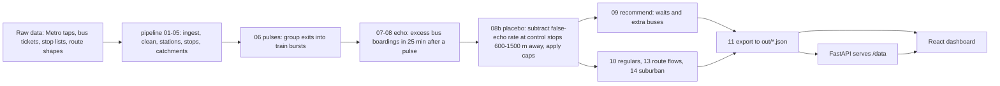

# Pulse-Echo

Entry for the **CUMTA Hackathon, Problem Statement 3: "Discover the Hidden Connections"**. It estimates where Chennai Metro passengers switch to buses (and back), what share goes to each nearby bus stop and route, how long they wait, and where extra buses would help most.

**Links:** [GitHub](https://github.com/shriram-s7/pulse-echo)

## Overview

Metro and bus operators have no direct record of who transfers between the two systems, because a Metro tap and a bus ticket are not linked. Pulse-Echo infers it. **Trains release passengers in bursts (pulses).** Buses that arrive at nearby stops shortly after a pulse carry extra boardings above the normal local level, and that excess is the **echo**. The echo is the estimated transfer. The analysis uses Metro entry/exit taps and about a month of bus-ticket data for March 2026 (main window 3 to 6 March), keeps every assumption in `config.yaml`, and flags bad rows instead of deleting them. The result feeds a dashboard that shows hotspots, waits and "fix it" recommendations.

## Features

Dashboard screens (`web/`):
- **Station map** with transfer hotspots.
- **Station panel:** pulse versus echo chart, routes, waits and regular commuter flows.
- **Fix it:** ranked recommendations for extra buses with the passenger-minutes they would save.
- **How it works:** the method, assumptions and limits.

Pipeline outputs (`out/`): stations, hotspots, flows, recommendations, regulars, per-station route flows, suburban flows, a method description and a quality report.

## How it works



Details of the method are in `out/method.json` and the in-app "How it works" screen. Key settings (`config.yaml`): a 400 m treatment radius (widened to 700 m for some stations), control rings at 600 and 1500 m, a 25-minute maximum transfer window, a 1.3 walk factor at 1.2 m/s, and a 35% per-stop and 50% per-station share cap.

### Headline results (quick estimates)

From `out/PITCH_NUMBERS.md`: about **55,000 bus transfers per day**, roughly **26% of about 212,000 Metro exits per day** (3 to 6 March average); Central, Thirumangalam and Guindy are the largest hotspots; the recommendations propose 15 extra buses and about 5,800 passenger-minutes saved per day. The placebo correction lowers the raw echo estimate from about 179,000 to about 55,000 transfers per day. These are indicative figures, not validated ground truth.

## Tech stack

| Layer | Technology |
|---|---|
| Pipeline | Python, Polars, pandas, GeoPandas, Shapely, PyProj, RapidFuzz, scikit-learn, statsmodels, SciPy |
| API | FastAPI, Uvicorn (static `/data` plus a placeholder `/ws/sensors` socket) |
| Dashboard | React 19, TypeScript, Vite, deck.gl, react-map-gl with Mapbox GL / MapLibre, ECharts |

## Project structure

```text
pipeline/   numbered scripts 01-15 plus run_all.py (ingest, clean, stations, stops, catchments, pulses,
            bus arrivals, quick transfers, placebo, recommend, regulars, export, contract check,
            route flows, suburban, consistency check)
api/        FastAPI app serving the exported JSON at /data and a /ws/sensors socket
web/        React + TypeScript + Vite dashboard; mock data in web/public/mock so the UI runs without the pipeline
out/        exported JSON the dashboard reads (stations, hotspots, flows, recommendations, regulars, method, quality report, route_flows/)
data/ref/   small reference tables (bus stops, stations, matched stops, POI zones)
config.yaml analysis settings
PHASES.md   the original build plan and the backend/frontend data contract
```

## Getting started

Prerequisites: Node.js 18+ for the dashboard; Python 3.10+ only if you want to serve results through the API or re-run the pipeline.

**Run the dashboard (no raw data needed)**

```powershell
cd web
npm ci
npm run dev          # http://localhost:5173, uses web/public/mock until the API is reachable
```

```bash
cd web && npm ci && npm run dev
```

Optional environment variable in `web/.env` (copy `web/.env.example`): `VITE_MAPBOX_TOKEN`, a Mapbox access token. Leave it empty to use MapLibre with the Carto Positron basemap.

**Serve the exported results through the API**

```powershell
python -m venv .venv
.\.venv\Scripts\Activate.ps1
pip install -r requirements.txt
uvicorn api.main:app --host 127.0.0.1 --port 8000
```

On Linux/macOS use `source .venv/bin/activate`. `start_demo.bat` starts the API and web app together on Windows. The dashboard falls back to the mock data when the API is not available.

**Re-run the pipeline (needs the raw data)**

The CUMTA raw data is **not** in this repository. Set `data_path` in `config.yaml` (default `E:/CUMTA HACKATHON/Theme 3`) to a folder that contains `CMRL_Entry.csv`, `CMRL_Exit.csv`, the daily `ETM/Ticket-Data-2026-03-DD.csv.bz2` bus-ticket files, the GCC/Avadi/Tambaram bus-stop workbook and the Metro and MTC route shapefiles. Run the scripts in `pipeline/` in numeric order, or `python pipeline/run_all.py` for the analysis steps from `06_pulses.py` onward once the cached data in `data/interim/` exists.

## Usage

1. Start the dashboard and open the station map.
2. Click a station to see its pulse versus echo chart, the bus routes that receive its passengers and the waits.
3. Open **Fix it** for the ranked extra-bus recommendations, and **How it works** for the method and caveats.

## Tests

There is no unit-test suite. The pipeline includes a data-contract check (`pipeline/12_contract_check.py`) and a consistency check (`pipeline/15_consistency.py`); neither was run here because they need the raw data. Observed while writing this README: `npm ci` and `npm run build` in `web/` succeeded (with a chunk-size warning). The API and the pipeline were not run.

## Status and limitations

- The dashboard and the pre-computed `out/` results are complete for the March 2026 sample; re-running the pipeline requires the private raw data and about 426 MB of cached intermediates (not committed).
- Transfers are a quick estimate: the placebo correction and the share caps are blunt, and Thirumangalam and Guindy exceed 40% of exits, so read them as indicative.
- Bus stops are matched by name, so terminals and large stops can merge several physical stops, and some stations have limited bus-stop data (flagged `data_quality = limited`).
- The `/ws/sensors` endpoint is a placeholder for a planned hardware/sensor phase and sends no data.
- Bad rows in the source data are flagged, not deleted; counts are in `out/quality_report.json`.

## License

No license specified.
